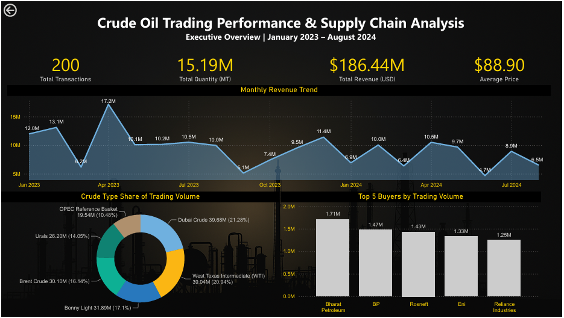
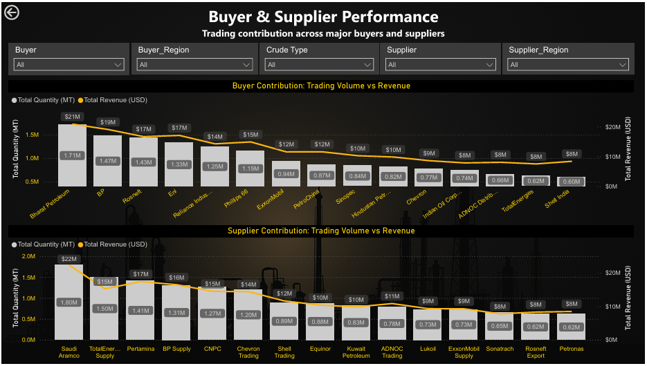
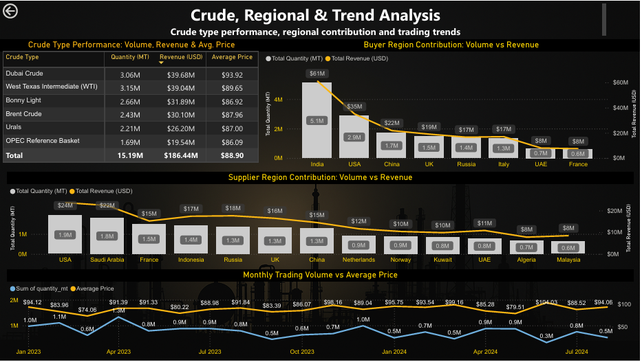

# Crude Oil Trading Performance & Supply Chain Analysis

<p align="center">
  
  
  
  
</p>

<p align="center">
  <strong>A SQL and Power BI portfolio project analyzing crude oil trading performance, participant contribution, crude types, regional distribution, and trading trends.</strong>
  <br>
  The project combines transaction, buyer, and supplier data to generate business-focused insights from 200 crude oil trading records covering January 2023 to August 2024.
</p>

---

## 📑 Table of Contents

- [About This Project](#about-this-project)
- [Problem Statement](#problem-statement)
- [Business Questions](#business-questions)
- [Dataset Overview](#dataset-overview)
- [Project Structure](#project-structure)
- [Methodology](#methodology)
  - [1. SQL Data Preparation](#1-sql-data-preparation)
  - [2. SQL Business Analysis](#2-sql-business-analysis)
  - [3. KPI Calculation](#3-kpi-calculation)
  - [4. Power BI Dashboard](#4-power-bi-dashboard)
- [Key Findings](#key-findings)
- [Business Recommendations](#business-recommendations)
- [Technical Specifications](#technical-specifications)
- [How to Review the Project](#how-to-review-the-project)
- [Limitations](#limitations)
- [Author](#author)

---

## About This Project

This project analyzes crude oil trading activity using SQL for data preparation and business analysis and Power BI for interactive visualization.

The analysis focuses on the contribution of buyers and suppliers, crude type performance, buyer and supplier regions, and changes in trading activity over time.

The project demonstrates:

- **SQL data preparation:** Combining transaction, buyer, and supplier data using joins.
- **Business-oriented SQL analysis:** Answering five defined business questions through analytical queries.
- **KPI calculation:** Evaluating traded quantity, calculated revenue, average price, and transaction count.
- **Power BI reporting:** Presenting key metrics and comparisons through a three-page dashboard.
- **Business interpretation:** Translating observed patterns into practical recommendations while acknowledging data limitations.

---

## Problem Statement

Crude oil trading performance can vary across buyers, suppliers, crude types, regions, and time periods. Examining only one metric, such as traded quantity or average price, may not provide a complete view of trading activity.

This project uses transaction-level data to evaluate trading contribution and identify patterns across participants, crude types, geography, and time.

The analysis is designed to answer the following business questions.

---

## Business Questions

1. **Buyer and Supplier Contribution:** Which buyers and suppliers contribute the most to crude oil trading activity in terms of traded quantity and calculated revenue?
2. **Crude Type Performance:** Which crude oil types have the greatest commercial contribution, and how do pricing levels differ?
3. **Regional Contribution:** Which buyer and supplier regions account for the largest share of trading activity?
4. **Trading Trends:** How does crude oil trading activity change over time, and which periods show notable changes?
5. **Overall Performance:** What is the overall trading performance in terms of transactions, quantity, average price, and calculated revenue?

---

## Dataset Overview

The project uses three source CSV files.

| Dataset | Description |
|---|---|
| `transaction_data.csv` | Transaction-level trading records, including crude type, quantity, price, date, and related identifiers |
| `buyers_data.csv` | Buyer details and buyer-region information |
| `suppliers_data.csv` | Supplier details and supplier-region information |

### Dataset Summary

| Attribute | Details |
|---|---|
| Analysis period | January 2023 – August 2024 |
| Transaction records | 200 |
| Buyer records | 15 |
| Supplier records | 15 |
| Source format | CSV |
| SQL preparation output | `PowerBI_Source_SQL_Output.csv` |

The consolidated SQL output combines the relevant transaction, buyer, supplier, and regional fields required for the analysis. The transaction ID is retained in the raw transaction dataset but is not included in the consolidated analytical output because it is not used in the dashboard analysis.

---

## Project Structure

```text
Crude Oil Supply Chain & Sales Management/
│
├── Case Study.docx
│
├── Dataset/
│   ├── buyers_data.csv
│   ├── suppliers_data.csv
│   └── transaction_data.csv
│
├── SQL/
│   ├── 01_PowerBI_Source_Preparation.sql
│   └── 02_Crude_Oil_Supply_Chain_Analysis.sql
│
├── SQL Output/
│   ├── PowerBI_Source_SQL_Output.csv
│   ├── Q01_Buyer_Supplier_Performance.csv
│   ├── Q02_Crude_Type_Performance.csv
│   ├── Q03_Regional_Performance.csv
│   ├── Q04_Monthly_Trading_Trend.csv
│   └── Q05_Overall_Transaction_Performance.csv
│
├── Power BI/
│   ├── Crude_Oil_Supply_Chain_Sales_Analysis.pbix
│   └── Crude_Oil_Supply_Chain_Sales_Analysis.pdf
│
├── Screenshots/
│   ├── Page_1_Executive_Overview.PNG
│   ├── Page_2_Buyer_Supplier_Performance.PNG
│   └── Page_3_Crude_Regional_Trend_Analysis.PNG
│
├── Documentation/
│   ├── Crude_Oil_Trading_Performance_Supply_Chain_Analysis_Report.docx
│   └── Crude_Oil_Trading_Performance_Supply_Chain_Analysis_Report.pdf
│
└── README.md
```

---

## Methodology

### 1. SQL Data Preparation

The first SQL script prepares a consolidated transaction-level dataset by joining transaction data with buyer and supplier information.

The preparation process:

- Combines relevant transaction, buyer, and supplier information.
- Adds buyer and supplier region details.
- Produces a consolidated CSV for use as the Power BI data source.

**Output:** `PowerBI_Source_SQL_Output.csv`

### 2. SQL Business Analysis

The second SQL script contains analytical queries organized around the five business questions.

| Query Output | Purpose |
|---|---|
| `Q01_Buyer_Supplier_Performance.csv` | Compares buyer and supplier contributions |
| `Q02_Crude_Type_Performance.csv` | Evaluates crude types by trading metrics |
| `Q03_Regional_Performance.csv` | Compares buyer- and supplier-region activity |
| `Q04_Monthly_Trading_Trend.csv` | Examines monthly trading patterns |
| `Q05_Overall_Transaction_Performance.csv` | Summarizes overall trading performance |

The consolidated Power BI source is kept separately from the five analytical outputs because it serves a different purpose: supplying the dashboard's underlying data.

### 3. KPI Calculation

The project uses four core performance indicators:

| KPI | Description |
|---|---|
| Total Transactions | Number of transaction records |
| Total Quantity Traded | Sum of traded quantity, measured in metric tonnes (MT) |
| Average Price | Average recorded price per barrel, in USD |
| Calculated Revenue | Project-defined revenue metric calculated using the formula below |

### Revenue Formula

```sql
SUM((quantity_mt * price_per_barrel) / 7.33)
```

This project-defined formula is used in the SQL analysis and Power BI calculations.

**Important:** Calculated revenue should not be interpreted as profit. Operating costs, procurement costs, transportation costs, and profit margins are not available in the dataset.

### 4. Power BI Dashboard

The dashboard contains three pages designed for different analytical perspectives.

#### Page 1 — Executive Overview

Provides a high-level summary of trading performance through KPI cards for total transactions, traded quantity, calculated revenue, and average price. It also includes a monthly calculated revenue trend, the top five buyers by traded quantity, and crude type volume share.

#### Page 2 — Buyer & Supplier Performance

Compares buyer and supplier contributions using traded quantity and calculated revenue. Slicers allow users to explore buyers, suppliers, and their respective regions.

#### Page 3 — Crude, Regional & Trend Analysis

Examines buyer- and supplier-region contributions, monthly trading quantity alongside average price, and crude type performance.

The dashboard is designed to compare related metrics together rather than relying on a single indicator.

### Dashboard Screenshots

**Executive Overview**



**Buyer & Supplier Performance**



**Crude, Regional & Trend Analysis**



---

## Key Findings

### 1. Buyer Contribution

- Bharat Petroleum was the largest buyer by traded quantity, contributing approximately **1.71 million MT** and **$20.86 million** in calculated revenue.
- The top five buyers accounted for **47.31% of total traded quantity** when ranked by quantity and **47.14% of calculated revenue** when ranked by revenue.

**Interpretation:** A relatively small group of buyers accounts for nearly half of the trading activity represented in the dataset.

### 2. Supplier Contribution

- Saudi Aramco was the largest supplier by traded quantity, contributing approximately **1.80 million MT** and **$22.39 million** in calculated revenue.
- The top five suppliers accounted for **47.88% of total traded quantity** and **46.16% of calculated revenue**, with rankings determined separately for each metric.

**Interpretation:** Supplier contribution is concentrated among leading participants, while activity remains distributed across multiple suppliers.

### 3. Crude Type Performance

- West Texas Intermediate (WTI) recorded the highest traded quantity at approximately **3.15 million MT**.
- Dubai Crude generated the highest calculated revenue at approximately **$39.68 million**.
- Dubai Crude's average recorded price was **$93.92/bbl**, compared with **$89.65/bbl** for WTI.

**Interpretation:** The crude type with the highest traded quantity is not necessarily the one with the highest calculated revenue. Price levels also affect the comparison.

### 4. Regional Contribution

- India was the largest buyer region, with approximately **5.12 million MT** and **$61.19 million** in calculated revenue.
- India represented **33.67% of total traded quantity** and **32.82% of calculated revenue**.
- The USA was the largest supplier region by quantity, accounting for approximately **12.67% of total traded quantity** and **12.72% of calculated revenue**.

**Interpretation:** Buyer activity was more geographically concentrated than supplier activity in this dataset.

### 5. Trading Trends

- April 2023 recorded the highest monthly transaction count (**19 transactions**), traded quantity (approximately **1.33 million MT**), and calculated revenue (approximately **$17.16 million**).
- June 2024 recorded the highest monthly average price at **$104.03/bbl**, while traded quantity was approximately **0.33 million MT** and calculated revenue was approximately **$4.70 million**.

**Interpretation:** A high average price does not automatically translate into high calculated revenue when traded quantity is low.

### Overall KPI Summary

| Metric | Result |
|---|---:|
| Total Transactions | 200 |
| Total Quantity Traded | 15.19 million MT |
| Calculated Revenue | $186.44 million |
| Average Price | $88.90/bbl |
| Analysis Period | January 2023 – August 2024 |

---

## Business Recommendations

1. **Manage participant concentration:** Maintain strong relationships with high-contribution buyers and suppliers while retaining alternative trading relationships.
2. **Evaluate crude types using multiple metrics:** Compare traded quantity, calculated revenue, and average price together rather than relying on volume alone.
3. **Monitor regional concentration:** Track buyer and supplier region contributions and evaluate opportunities to diversify trading relationships where appropriate.
4. **Track price and quantity jointly:** Review average price alongside traded quantity and calculated revenue to avoid drawing conclusions from price movements alone.

These recommendations reflect patterns observed in the available dataset and are not a substitute for profitability or operational analysis.

---

## Technical Specifications

| Component | Technology / Approach |
|---|---|
| Data input | CSV files |
| Data preparation | SQL joins |
| Business analysis | SQL aggregation, grouping, and analytical queries |
| Dashboard | Microsoft Power BI |
| Measures | DAX |
| Output formats | CSV, PBIX, PDF, DOCX, Markdown |
| Analysis type | Descriptive and exploratory business analysis |

---

## How to Review the Project

### 1. Review the Source Data

Open the files in `Dataset/` to inspect the transaction, buyer, and supplier data.

### 2. Review the SQL Scripts

Open the scripts in `SQL/` in a compatible SQL environment.

- Run `01_PowerBI_Source_Preparation.sql` to prepare the consolidated analytical dataset.
- Run `02_Crude_Oil_Supply_Chain_Analysis.sql` to review the analytical queries answering the five business questions.

The scripts may require the corresponding source tables to be imported and the database/schema references to be configured for your environment.

### 3. Review the SQL Outputs

Inspect the consolidated Power BI source and the five business-question CSV files in `SQL Output/`.

### 4. Open the Power BI Dashboard

Open `Power BI/Crude_Oil_Supply_Chain_Sales_Analysis.pbix` using Microsoft Power BI Desktop.

If required, update the data source path to match your local copy of `PowerBI_Source_SQL_Output.csv`, then refresh the data.

### 5. Read the Documentation

The `Documentation/` folder contains the project report in DOCX and PDF formats, describing the business context, approach, findings, recommendations, and limitations.

The `Case Study.docx` file contains the project case study and business questions.

---

## Limitations

- **Dataset scope:** The analysis covers 200 transaction records from January 2023 to August 2024.
- **Calculated revenue:** Revenue uses the project's defined formula and conversion factor; it is not a measure of profit.
- **Cost information:** Operating, procurement, and transportation costs and profit margins are not provided.
- **Operational information:** Contract terms, delivery lead times, supplier quality, and other operational measures are unavailable.
- **Interpretation:** Findings describe patterns in the supplied dataset and should not automatically be generalized to the entire crude oil industry.
- **Data provenance:** The repository uses the supplied project datasets; external data validation is outside the scope of this analysis.

---

## Author

**Agamya Jain**

Data Analyst Portfolio Project

---

<p align="center">
  <strong>Crude Oil Trading Performance & Supply Chain Analysis</strong>
  <br>
  SQL • Power BI • DAX • Business Insights
</p>
